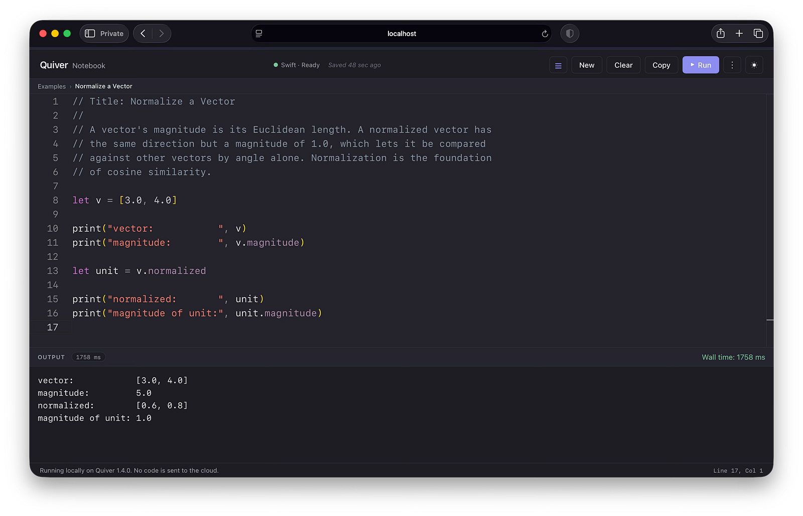

# Quiver Notebook — A browser-based Swift editor for data science

[](https://swift.org)
[]()
[](LICENSE)

The Quiver Notebook is a local, browser-based Swift editor for exploring vectors, matrices, statistics, and machine learning with [Quiver](https://github.com/waynewbishop/quiver). One clone and one command produce a working editor with Quiver, Foundation, and a library of teaching datasets already wired in — no Xcode, no accounts, no telemetry, and nothing leaves your Mac.



## Who the Notebook is for

**Students** working through a course, textbook, or self-study get a Swift environment that does numerical work without installing additional binaries, configuring system packages, or downloading datasets separately. Vector and matrix results render in the output pane as legible math, not comma-separated arrays.

**Educators** preparing lectures or assignments can fork the repository, drop custom example files into the `examples-custom/` folder, and distribute the URL to a class. The bundled stack covers an applied linear algebra unit, an introductory descriptive statistics segment, an applied regression module, and a short supervised-learning survey with k-nearest neighbors, k-means, and Naive Bayes.

**Apple-platform developers** prototyping a model or testing an idea get a focused editor without a project workspace. Code that runs here compiles unchanged on any Apple platform — iOS, watchOS, visionOS — and on server-side Swift. [True Effort Score](https://waynewbishop.github.io/quiver/documentation/quiver/true-effort-score), Quiver's training-load model for Apple Watch, shows where that path leads: prototype here, ship to the watch.

## Quick Start

Requires macOS 15 (Sequoia) or newer and the Swift 6 toolchain. The steps below install everything through [Homebrew](https://brew.sh), the standard macOS package manager — it keeps the toolchain updated and uninstalls cleanly. If you already have Swift 6, skip to step 4.

### 1. Install Homebrew

Open **Terminal** (Applications → Utilities, or search "Terminal" in Spotlight). Paste this command and press Return — it runs the official install script from [brew.sh](https://brew.sh):

```bash
/bin/bash -c "$(curl -fsSL https://raw.githubusercontent.com/Homebrew/install/HEAD/install.sh)"
```

On a fresh Mac, the installer first prompts for Apple's Command Line Tools — a one-time Apple step, not a hang. The install takes a few minutes and may ask for the Mac's password. When it finishes, confirm it works:

```bash
brew --version
```

You should see a line like `Homebrew 4.4.0`. If you get "command not found," close the terminal window, open a new one, and try again.

### 2. Install Swiftly

**Swiftly** is Swift's official toolchain installer, maintained by the Swift project:

```bash
brew install swiftly
```

### 3. Install the Swift toolchain

```bash
swiftly init
```

The download takes a few minutes. Confirm Swift is available:

```bash
swift --version
```

You should see `Swift version 6.` followed by a minor and patch number. If you get "command not found," open a new terminal window — installs only take effect in new sessions.

### 4. Clone and run

```bash
git clone https://github.com/waynewbishop/quiver-notebook
cd quiver-notebook
swift run
```

The first launch takes a minute or two while Swift compiles the Notebook and pre-warms the snippet sandbox. Later runs start in seconds. When the server is ready, the terminal prints:

```
==========================================================
  Quiver Notebook is running.

  Open this URL in your browser:
  http://localhost:8080

  If port 8080 is in use, restart with: PORT=8090 swift run
==========================================================
```

Open the URL in any browser and start writing snippets. Press `Ctrl+C` in the terminal to stop the server.

## Bundled datasets

A small library of teaching datasets — iris, Titanic, California Housing, and others — loads by name with a single line of code: no download, no parsing, no setup. A separate loader reads any CSV from disk in the same shape, so a class can move from bundled data to its own data without changing the rest of a snippet. See [Notebook Datasets](https://waynewbishop.github.io/quiver/documentation/quiver/notebook-datasets) for the full menu and loading API.

## Bundled examples

The editor's sidebar lists ready-to-run snippets, ordered from simplest to most complex — each loads with one click. The Notebook reads two folders: `examples/` for the bundled set and `examples-custom/` for your own. Drop new `.swift` files into `examples-custom/` — no plugin system, no manifest, no rebuild; restart `swift run` to pick them up. A `// Title:` comment on each file's first line becomes its sidebar label.

## Privacy

The Notebook keeps your work on your own Mac. There are no accounts, no telemetry, and no analytics. Code, bundled datasets, and CSVs loaded from disk are read by the local process and never leave the machine.

Only the Notebook's own editor can run code. The local server answers on `127.0.0.1`, making it reachable from this Mac alone, and refuses to start if the address is changed. Each launch creates a private key that the editor uses behind the scenes every time you press Run.

## Learn Quiver

The Notebook is one stop on the Quiver learning path:

- **[Quiver](https://github.com/waynewbishop/quiver)** — the framework powering every snippet.
- **[Cookbook](https://github.com/waynewbishop/quiver-cookbook)** — 75 interactive recipes for the Xcode `#Playground` macro.
- **[Documentation & primers](https://waynewbishop.github.io/quiver/documentation/quiver/)** — linear algebra, statistics, and ML primers, plus:
  - [Quiver Notebook](https://waynewbishop.github.io/quiver/documentation/quiver/quiver-notebook) — setup, snippet rules, app handoff
  - [Notebook Datasets](https://waynewbishop.github.io/quiver/documentation/quiver/notebook-datasets) — the bundled library and CSV loader
  - [Quiver Notebook for Classrooms](https://waynewbishop.github.io/quiver/documentation/quiver/quiver-notebook-for-classrooms) — fork-and-distribute, custom examples, version pinning
- **[Swift Algorithms & Data Structures](https://waynewbishop.github.io/swift-algorithms/)** — the free companion book for deeper foundations.

## Contributing

Pull requests for `examples/` are especially welcome. For other contributions or questions, open an issue or reach out on [LinkedIn](https://www.linkedin.com/in/waynebishop).

## License

MIT. See the LICENSE file for more info.
